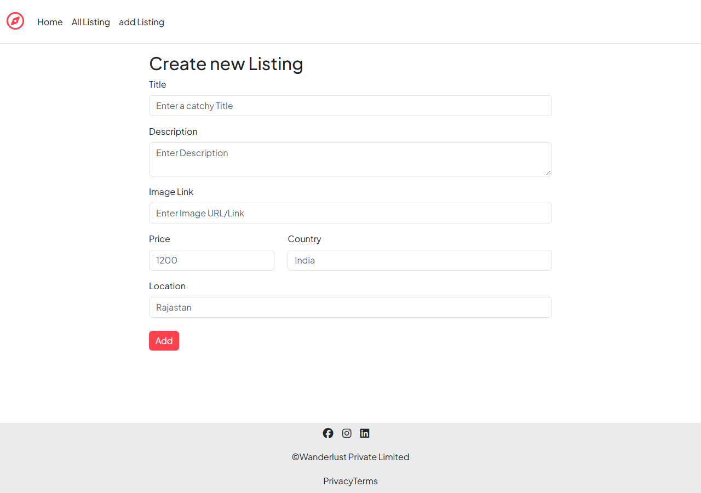

# 🏡 Wanderlust — Airbnb Clone

[](https://nodejs.org/)
[](https://expressjs.com/)
[](https://www.mongodb.com/)
[](https://getbootstrap.com/)
[](LICENSE)

> 🌱 **Milestone Project**: This was my **very first full-stack web development project**, crafted 4 years ago when I embarked on my software engineering journey. It represents where my passion for building web applications began!

---

## 📖 Overview

**Wanderlust** is a full-stack vacation rental web platform inspired by Airbnb. Built with the **MVC (Model-View-Controller)** pattern, it enables users to explore vacation rentals, view detailed property information, post new accommodations, edit or delete listings, and leave feedback and star ratings.

---

## ✨ Features

- 🏠 **Explore Listings**: Responsive card grid with high-resolution imagery, pricing, and locations.
- 🔍 **Detailed Property View**: In-depth view for each accommodation including pricing per night, description, location, and country.
- ➕ **Add New Listing**: Clean form interface to create listings with client-side and server-side validation.
- ✏️ **Edit & Update**: Seamlessly edit existing listings using HTTP `PUT` (via `method-override`).
- 🗑️ **Delete Listing**: Safely remove listings with HTTP `DELETE`.
- ⭐ **Reviews & Ratings**: Add user ratings and comments on properties.
- 🛡️ **Schema Validation & Error Handling**: Robust server-side validation with **Joi** schemas and custom asynchronous error handlers (`wrapAsync`, `ExpressError`).
- 📱 **Mobile & Desktop Responsive**: Clean UI designed with Bootstrap 5, Font Awesome icons, and modern typography.

---

## 📸 Screenshots

### 1. Home / All Listings Page
Explore vacation stays from around the world in a modern, responsive grid.


---

### 2. Listing Details & Review Section
Comprehensive details for each property with options to edit, delete, or leave a review.


---

### 3. Create New Listing
Intuitive form with client-side feedback and validation.


---

### 4. Edit Listing
Easily update existing property details.


---

## 🛠️ Tech Stack

| Category | Technology |
|---|---|
| **Runtime** | [Node.js](https://nodejs.org/) |
| **Backend Framework** | [Express.js](https://expressjs.com/) |
| **Database** | [MongoDB](https://www.mongodb.com/) with [Mongoose ODM](https://mongoosejs.com/) |
| **Templating Engine** | [EJS](https://ejs.co/) with [EJS-Mate](https://github.com/palmerhh/ejs-mate) layouts |
| **Validation** | [Joi](https://joi.dev/) schema validator |
| **Frontend & Styling** | HTML5, CSS3, JavaScript (ES6+), [Bootstrap 5](https://getbootstrap.com/), [Font Awesome](https://fontawesome.com/) |

---

## 📁 Project Structure

```text
AirBnb_Clone/
├── init/                  # Database initialization and sample dataset
│   ├── data.js            # Sample listings data
│   └── index.js           # Database seeding script
├── models/                # Mongoose database schemas & models
│   ├── listing.js         # Listing model
│   └── review.js          # Review model
├── public/                # Static assets
│   ├── css/style.css      # Custom styling
│   └── js/script.js       # Client-side validation scripts
├── utils/                 # Utility functions & error wrappers
│   ├── ExpressError.js    # Custom Express error class
│   └── wrapAsync.js       # Async error handling wrapper
├── views/                 # EJS templates (MVC Views)
│   ├── includes/          # Partials (navbar, footer)
│   ├── layouts/           # Master boilerplate layout
│   ├── listings/          # CRUD views (index, show, new, edit)
│   └── error.ejs          # Error page template
├── screenshots/           # Application screenshots for documentation
├── app.js                 # Express application entry point
├── package.json           # Dependencies and scripts
└── schema.js              # Joi validation schema
```

---

## 🚀 Getting Started

Follow these instructions to run the project locally on your machine.

### Prerequisites

Ensure you have installed:
- [Node.js](https://nodejs.org/) (v16 or higher)
- [MongoDB Community Server](https://www.mongodb.com/try/download/community) running locally on port `27017`
- [Git](https://git-scm.com/)

---

### Installation & Setup

1. **Clone the repository:**
   ```bash
   git clone https://github.com/krishna-Deshmukh13/AirBnb_Clone.git
   cd AirBnb_Clone
   ```

2. **Install dependencies:**
   ```bash
   npm install
   ```

3. **Make sure MongoDB is running:**
   ```bash
   # On Windows:
   net start MongoDB
   
   # Or using mongod:
   mongod
   ```

4. **Initialize / Seed Sample Data:**
   ```bash
   npm run init-db
   ```

5. **Start the development server:**
   ```bash
   npm start
   # or with nodemon:
   npm run dev
   ```

6. **Open in your browser:**
   ```text
   http://localhost:8080
   ```

---

## 📡 RESTful Routes

| Method | Endpoint | Description |
|---|---|---|
| `GET` | `/` | Redirects to `/listings` |
| `GET` | `/listings` | Display all listings (Index) |
| `GET` | `/listings/new` | Form to create a new listing (New) |
| `POST` | `/listings` | Create a new listing in DB (Create) |
| `GET` | `/listings/:id` | Display specific listing details (Show) |
| `GET` | `/listings/:id/edit` | Form to edit an existing listing (Edit) |
| `PUT` | `/listings/:id` | Update a listing in DB (Update) |
| `DELETE` | `/listings/:id` | Delete a listing from DB (Delete) |
| `POST` | `/listings/:id/reviews` | Add a review to a listing |

---

## 💡 Key Learnings & Takeaways

As my first real-world project, building this application provided deep insights into:
- The **fundamentals of client-server architecture** and the REST API convention.
- Structuring scalable applications with the **Model-View-Controller (MVC)** architectural pattern.
- Database modeling, document referencing, and CRUD operations with **MongoDB & Mongoose**.
- Robust server-side input validation and error handling using **Joi** schemas.
- Using templating engines (**EJS**) with layouts to achieve modular and reusable UI components.

---

## 👤 Author

**Krishna Deshmukh**
- GitHub: [@krishna-Deshmukh13](https://github.com/krishna-Deshmukh13)

---

## 📄 License

This project is open-source and available under the [MIT License](LICENSE).
