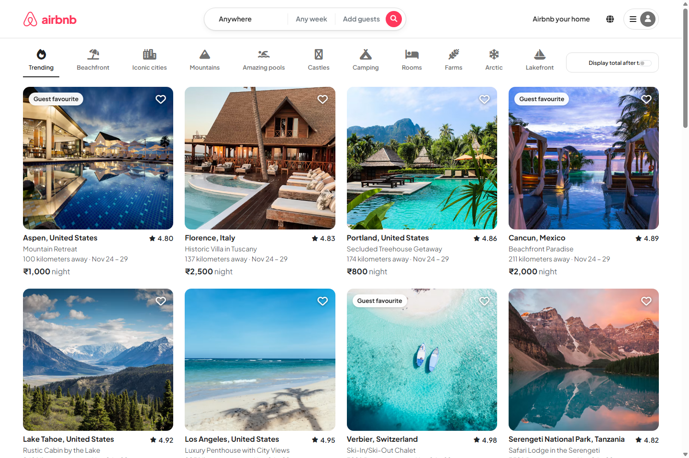
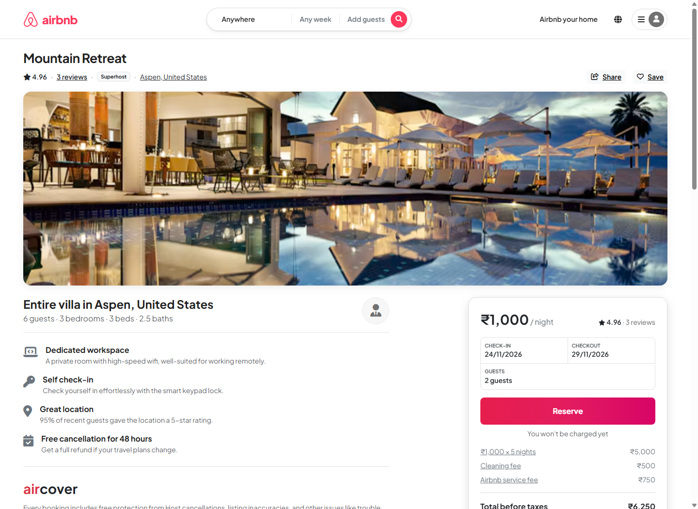
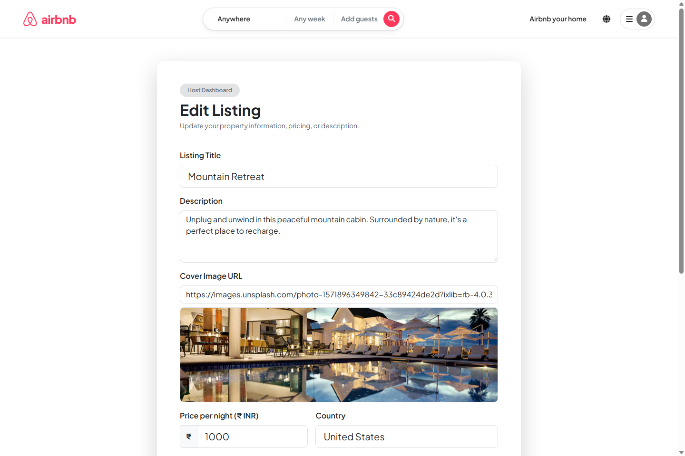

# 🏡 Airbnb Clone — Full-Stack Vacation Rental Platform

[](https://nodejs.org/)
[](https://expressjs.com/)
[](https://www.mongodb.com/)
[](https://getbootstrap.com/)
[](LICENSE)

> 🌱 **Milestone Project**: This was my **first full-stack web development project**, originally built 4 years ago when I began learning web development. I have continuously upgraded it to mirror the authentic design, UI polish, and responsiveness of the modern **Airbnb** platform!

---

## 📖 Overview

This project is a high-fidelity **Airbnb Clone** built using the **Model-View-Controller (MVC)** architectural pattern with Node.js, Express, MongoDB, and EJS. It replicates the core user flow of Airbnb, including listing exploration, category-based filtering, instant destination search, interactive wishlist hearts, price tax calculation, detailed stay views with sticky reservation cards, and full CRUD operations for hosts.

---

## ✨ Features & Airbnb Design System

- 🔍 **Interactive Search Pill**: Header search bar offering instant client-side and server-side filtering across destinations, titles, and countries.
- 🏷️ **Horizontal Category Bar**: 12+ Airbnb category filters (Trending, Beachfront, Iconic cities, Mountains, Pools, Castles, Camping, etc.) with real-time filtering.
- 💸 **Display Total After Taxes Switch**: Real-time toggle that recalculates and reveals GST on accommodation prices.
- ❤️ **Interactive Wishlist Hearts**: Smooth heart toggling on listing cards to favorite accommodations.
- 🌟 **Guest Favourite Badges**: Visual indicators highlighting top-rated properties.
- 🏡 **Rich Stay Details Page**:
  - High-resolution hero image showcase.
  - Verified host information and stay highlights (Self check-in, Dedicated workspace, Free cancellation).
  - Authentic **AirCover** protection badge.
  - Comprehensive amenities grid (Wi-Fi, pool, parking, chef's kitchen, air conditioning).
  - Sticky reservation card with automated night price calculation, cleaning fee, and service fee breakdown.
- ⭐ **Reviews & Rating Sub-metrics**: Community reviews with star ratings and detailed category scores (Cleanliness, Accuracy, Communication, Location).
- 🛠️ **Host Dashboard & CRUD**: Create and update listings with responsive forms, live image preview, and Joi schema validation.
- 📱 **Fully Responsive**: Mobile-first design with responsive search pill and collapse layouts across all viewports.

---

## 📸 Screenshots

### 1. Home / All Listings Page
Authentic Airbnb header, search pill, category filter carousel, tax switch, and card grid with ratings.


---

### 2. Property Details & Sticky Reservation Card
Property hero image, stay highlights, amenities grid, reviews breakdown, and floating booking widget.


---

### 3. Host a Property (Create Listing)
Clean host onboarding form with input validation and instant cover image preview.


---

### 4. Edit Listing Interface
Host dashboard interface to modify pricing, description, and accommodation details.


---

## 🛠️ Tech Stack

| Category | Technology |
|---|---|
| **Runtime Environment** | [Node.js](https://nodejs.org/) |
| **Server Framework** | [Express.js](https://expressjs.com/) |
| **Database** | [MongoDB](https://www.mongodb.com/) & [Mongoose ODM](https://mongoosejs.com/) |
| **Templating Engine** | [EJS](https://ejs.co/) & [EJS-Mate](https://github.com/palmerhh/ejs-mate) |
| **Schema Validation** | [Joi](https://joi.dev/) |
| **Styling & UI** | [Bootstrap 5](https://getbootstrap.com/), [Font Awesome 6](https://fontawesome.com/), Custom Airbnb CSS |

---

## 📁 Project Structure

```text
AirBnb_Clone/
├── init/                  # Database initialization and sample data
│   ├── data.js            # Sample listings data
│   └── index.js           # Database seeding script
├── models/                # Mongoose models (MVC - Model)
│   ├── listing.js         # Listing schema & model
│   └── review.js          # Review schema & model
├── public/                # Static assets
│   ├── css/style.css      # Airbnb design system & styling
│   └── js/script.js       # Live search, category filters, wishlist & validation
├── utils/                 # Utilities & error handling
│   ├── ExpressError.js    # Custom Express error class
│   └── wrapAsync.js       # Async error wrapper
├── views/                 # EJS templates (MVC - View)
│   ├── includes/          # Partials (navbar, footer)
│   ├── layouts/           # Master boilerplate
│   ├── listings/          # Views: index, show, new, edit
│   └── error.ejs          # Error page template
├── screenshots/           # Application screenshots
├── app.js                 # Application entry point (MVC - Controller & routes)
├── package.json           # Dependencies and scripts
└── schema.js              # Joi validation schemas
```

---

## 🚀 Getting Started

### Prerequisites
- [Node.js](https://nodejs.org/) (v16+)
- [MongoDB Community Server](https://www.mongodb.com/try/download/community) running on default port `27017`

### Installation & Run

1. **Clone the repository:**
   ```bash
   git clone https://github.com/krishna-Deshmukh13/AirBnb_Clone.git
   cd AirBnb_Clone
   ```

2. **Install dependencies:**
   ```bash
   npm install
   ```

3. **Start MongoDB:**
   ```bash
   # Windows service:
   net start MongoDB
   ```

4. **Seed database with sample listings:**
   ```bash
   npm run init-db
   ```

5. **Start the server:**
   ```bash
   npm start
   # or with nodemon:
   npm run dev
   ```

6. **Open in browser:**
   ```text
   http://localhost:8080
   ```

---

## 📡 RESTful Endpoints

| Method | Endpoint | Description |
|---|---|---|
| `GET` | `/` | Redirects to `/listings` |
| `GET` | `/listings` | Index: Display all listings (supports `?q=` search) |
| `GET` | `/listings/new` | New: Render form to create listing |
| `POST` | `/listings` | Create: Save listing to database |
| `GET` | `/listings/:id` | Show: View details, reviews, and booking card |
| `GET` | `/listings/:id/edit` | Edit: Form to update an existing listing |
| `PUT` | `/listings/:id` | Update: Update listing details |
| `DELETE` | `/listings/:id` | Delete: Remove listing from database |
| `POST` | `/listings/:id/reviews` | Reviews: Add review to a listing |

---

## 👤 Author

**Krishna Deshmukh**
- GitHub: [@krishna-Deshmukh13](https://github.com/krishna-Deshmukh13)

---

## 📄 License

This project is licensed under the [MIT License](LICENSE).
